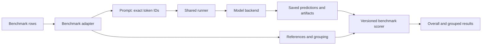

# Shared evaluation



Run from the repository root after supplying a checkpoint and local benchmark data:

```bash
uv run python -m evaluation.shared --config evaluation/configs/shared/controlled.yaml --output-dir output/shared/example
uv run python -m evaluation.shared --config evaluation/configs/shared/controlled.yaml --output-dir output/shared/example --score-only
```

All code and benchmark helpers live in this repository. External source clones are agent reference material only. Dataset files live under this repository’s `data/` directory; trained checkpoints and benchmark data remain normal evaluation inputs, not bundled source code.

The example YAMLs are templates, not claims that datasets/checkpoints have been downloaded. `dataset.revision` identifies the source/generator revision; the runner independently hashes the actual data. Every example in the supplied file is evaluated. Create a separate, recorded subset file for pilots; there is no silent truncation.

## Shared implementation owners

| Responsibility | Canonical implementation |
|---|---|
| Checkpoint configuration, read-scale validation, exact loading | `evaluation/models.py` |
| Durable JSON/JSONL, manifests, streamed artifact hashes | `evaluation/storage.py` |
| Generation capture and TaaL execution-block settings | `evaluation/shared/generation.py` |
| TaaL generation trace assembly and saved-trace validation | `evaluation/taal/trace_export.py` |
| Benchmark orchestration and grouped scoring | `evaluation/shared/runner.py` |

Both evaluation entry points use these implementations. Benchmark-specific renderers and metrics remain separate because their scoring semantics differ.

## Contracts and boundaries

- `Example` owns references and group metadata. Only its reference-free `Prompt` reaches `Backend.generate`.
- `Prediction` is always one dataclass. It contains generated IDs/text, stop reason, counts, synchronized generation time, CUDA peak allocation when available, completion status, and artifact references. Failed generations are logged separately and retried on resume.
- The runner saves exact input IDs, references, prompt/data/model/tokenizer fingerprints, dtype, seed, execution settings, and trace policy. Changes require another output directory. Local source content is hashed, including uncommitted implementation changes.
- Each question starts with fresh KV and memory. Related questions currently replay the full prefix independently. No cache reuse or snapshot/fork speedup is claimed. `snapshot` and `continuation_score` capabilities are false; requesting unsupported capabilities fails before moving the model to GPU.
- `QwenBackend` wraps existing TaaL and TTCD/Qwen generators; the legacy LongMemEval entry point now shares their generation/capture primitive. Historical TaaL state interventions remain in their specialized audit scripts.
- There is no Gated DeltaNet or static-adapter model implementation in this change. Add a backend once that architecture exists; no placeholder silently uses TaaL.

## Data and scores

| Adapter | Input | Scoring |
|---|---|---|
| `controlled` | `example_id`, rendered `prompt`, `answer` or `answers`; optional `group_id`, `metadata` | Case-folded, whitespace-trimmed exact match against an accepted answer |
| `controlled_prepared` | Historical workshop `input_ids`, `answer`, IDs and metadata | Same exact match, using generated multi-token text; not the historical one-token candidate score |
| `ruler` | Official NIAH JSONL: `index`, `input`, `outputs`, optional `answer_prefix` | Official reference-substring fraction, plus all-references-present and a strict joined-answer exact match |
| `babilong` | `example_id`, `input`, `question`, `target` | Bundled official task prompts and label-set scorer; source-file hashes identify their versions |
| `longmemeval` | Original question/session/date JSON fields | Existing external rubric via `--judge-only`; no exact-match replacement |

RULER supports all eight NIAH variants (single, multikey, multivalue, multiquery). It appends the official `answer_prefix` exactly once and does not apply a second chat template. Its official score is partial credit when only some requested values appear. Values here are fractions in `[0,1]`; multiply the aggregate by 100 and round to two decimals to compare with official RULER percentages. The extra joined-answer metric is order/format sensitive and is **not** the official metric.

BABILong prompt and scoring helpers are bundled in this repository, with their upstream licenses, revisions, and checksums under `evaluation/shared/vendor/`. No sibling source checkout or `benchmark.repo` setting is needed. Its default completion prompt includes the official task instructions and examples; this is explicitly not a model-specific chat/ICL sweep. Raw Hugging Face rows without IDs must receive stable `example_id` values when exported. Record the dataset revision independently of the source-code revision.

Controlled paired questions should share `group_id`. `group_all_correct` requires every question in the supplied group to be correct; group sizes are included, so incomplete groups remain visible. `metadata.task`, `length`, `gap`, `fact_count`, and `condition` produce separate summary strata. Do not mix paired experimental conditions into a question-selection group.

Prepared workshop data additionally requires `dataset.tokenizer_sha256` matching the backend tokenizer fingerprint. This prevents accidentally interpreting old token IDs using a different vocabulary. Obtain the fingerprint using `evaluation.shared.__main__.tokenizer_fingerprint(AutoTokenizer.from_pretrained(checkpoint))`. Prefer rendered text for new model-independent datasets.

LongMemEval preserves the existing segmented completion tokenization (or explicit `chat` policy). To judge after generation:

```bash
uv run python -m evaluation.shared --config evaluation/configs/shared/longmemeval.yaml --output-dir output/shared/lme --judge-only
```

Set judge credentials in the environment as with the existing runner. Judgments remain separate under `longmemeval_judge/`. `--score-only` reads stored examples and predictions without loading the model or tokenizer; versioned score files allow scorer changes without regenerating answers.

## Models and tracing

Use `model.mode: taal`, `swa`, `full`, or `fw_swa`. For attention-only baselines, load an untouched Qwen checkpoint (or a TTCD wrapper checkpoint with no fast-weight layers). For SWA128 set both teacher/student windows to 128 and a valid execution block. Full mode expands the attention window to cover every supplied prompt plus generation. Remote model sources require an immutable revision. Local checkpoint weights/config are fingerprinted.

`save_traces: true` is the default. All backends save common prompt/generated token trajectories. TaaL additionally exports unchanged `taal-memory-trace/v1` files under `memory_traces/` for the existing viewer. Baselines do not invent TaaL read/write events. Expected answers and final scores remain in `examples.json` and score files; they are never passed to generation.

Resume validates trace checksums, token/prediction agreement, and TaaL's viewer index. Missing required traces fail explicitly. Generation timing includes recorder hooks but excludes artifact serialization; CUDA peak allocation is allocated memory, not reserved memory or GPU utilization. Use a separate `save_traces: false` output directory for resource comparisons; that pass is labeled `trace-disabled`.

TaaL `model.settings.memory_read_scale` applies to the **whole episode**, not only the final question. Query-only interventions and memory swapping remain specialized audits, not equivalent settings in this ordinary-generation runner.

## Validation

```bash
uv run python -m unittest tests.test_shared_evaluation tests.test_longmemeval tests.test_taal_longmemeval tests.test_generation tests.test_taal_trace_export
```

CPU tests cover prompt/scorer semantics, multi-token and EOS generation, legacy parity, state independence, resume/corruption handling, and a saved-checkpoint CLI round trip. Official-source checks use pinned, bundled helpers and run without sibling checkouts. GPU precision/cache parity remains a separate validation step before publishing comparisons.

## Missing-information diagnostic

Generate the separate controlled abstention slice with `uv run python -m data.controlled_abstention`, then use `evaluation/configs/shared/controlled_abstention.yaml` with the intended checkpoint. It pairs present and absent queried keys and counterbalances each key's role across contexts. The default creates 128 questions; keep the whole `pair_id` together when splitting.

Rows declare `metadata.answerable` and `metadata.abstention_response`; the prompt explicitly requests that response (`UNKNOWN`) when absent. Reports separate correct abstention on missing keys from false abstention on present keys, alongside overall exact match and joint prefix correctness. This is strict protocol scoring, not LongMemEval's free-form judge. Existing controlled rows without these annotations keep their original metrics. No model results have been measured for this slice.
